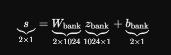

# 方法一 F1=79.7998

## 一、对英文数据的训练

### 1、建立分类头（本质是个线性层）

英文训练数据本来就有 sense_id，读取已有标签，建立分类头，一个词语有几个意思就建立一个输出几个向量的分类头，同时每个词都有自己的分类头，但它们共享同一个 XLM-R 编码器。

### 2．把句子转换为目标词向量

输入第一句话：

She deposited money at the bank.

XLM-R 编码整句话，为每个子词输出一个向量，程序根据 start/end 找到 bank 对应的向量。

原 joint 的训练池化方式是：

1. 对最后四层的输出取平均。

2. 对目标词对应的子词取平均。

3. 将结果归一化。

得到：

$$
z_{\text{bank}} \in \mathbb{R}^{1024}
$$

虽然只取 bank 位置的输出，但这个向量已经融合了整句上下文。 因此，“存钱句中的 bank”和“河边句中的 bank”可以得到不同向量。

### 3、分类头预测当前词义

将 z<sub>bank</sub> 输入 bank 专属的分类头：

假设这里的bank只有两个词义。

输出两个分数，经 softmax 转换为概率，这里会产生分类损失，采用交叉熵损失函数，取的是真实类别的预测概率，因为该数据有标签。

```python
label_map = {
    "finance": 0,    # 银行
    "riverside": 1,  # 河岸
}
```

$$s = \begin{bmatrix}
s_{0} \\
s_{1}
\end{bmatrix} = \begin{bmatrix}
银行的分数 \\
河岸的分数
\end{bmatrix}$$

| **预测情况**     | **银行的概率** | **河岸的概率** | **交叉熵损失**               |
|------------------|----------------|----------------|------------------------------|
| 不太相信正确答案 | 0.40           | 0.60           | $$- \ln 0.40 \approx 0.916$$ |
| 很相信正确答案   | 0.90           | 0.10           | $$- \ln 0.90 \approx 0.105$$ |

然后训练通过反向传播调整参数，推动“银行”的概率提高。

### 4、三元组损失直接约束向量之间的关系

（1）分类预测正确，还不等于向量一定适合余弦距离聚类。因此，原 joint 同时使用度量损失。）

（2）做瑞典语聚类时，我们会去掉英文分类头，直接比较目标词向量的余弦距离。

（那为啥还要分类头呢？直接做余弦距离聚类

答：因为英文训练词的分类头，只认识那个英文词的那套标签。例如 bank 的分类头只输出 finance/riverside，不能拿它判断瑞典语 skär 的词义，但所有词都共享 XLM-R。训练不同词时，损失会共同调整这个编码器，让它有机会学到更通用的“根据上下文区分目标词用法”的能力。）

| **角色** | **例句**           | **与锚点的关系** |
|----------|--------------------|------------------|
| 锚点 A   | 在 bank 存钱       | —                |
| 正例 P   | bank 批准贷款      | 同义             |
| 负例 N   | 坐在河流的 bank 上 | 异义             |

A该向量（XLM-R 编码整句话，为每个子词输出一个向量，程序根据 start/end 找到 bank 对应的向量）与P、N分别计算余弦相似度。

$$s_{AP} = \cos(z_{A},z_{P}),s_{AN} = \cos(z_{A},z_{N})$$

要求同义对比异义对更相似，并留出 margin=0.2（人为设定0.1-0.3还没有试过） 的间隔：

$$L_{A} = \max_{}(0,\mspace{6mu} 0.2 - s_{AP} + s_{AN})$$

等于0即，这组关系已经满足间隔要求。

“双向”还要检查正例 P 与负例 N 的关系

$$L_{P} = max(0,\mspace{6mu} 0.2 - s_{AP} + s_{PN})$$

$$L_{metric} = 1/2\left\lbrack 1/3\max(0,\mspace{6mu} 0.2 - s_{AP} + s_{AN_{k}}) + 1/3\sum_{k = 1}^{3}\max(0,\mspace{6mu} 0.2 - s_{AP} + s_{PN_{k}}) \right\rbrack$$

原代码每组实际采样三个负例，分别计算两种约束并取平均：

### 5．合并损失，反向传播

$L = L_{metric} + 0.2L_{CE}$（0.1-0.3都试过，结果相同）

## 二、对瑞典语的聚类

### 6．瑞典语 WSI：提取向量，再聚类

使用英文词义标注数据微调好的模型，来提取瑞典语目标词向量。

训练结束后，对瑞典语每条用法：

1. 输入原句。

2. 根据目标位置提取向量。

3. 同一个词的所有用法计算余弦距离。

4. 使用 complete 层次聚类，得到簇编号。

假设只有四个用法 A、B、C、D，初始就是四个簇：

$$\{ A\},\quad\{ B\},\quad\{ C\},\quad\{ D\}$$

complete 用“最远的一对”定义簇间距离

现在判断 {A,B} 和{C}能不能合并。假设：

$$d(A,C) = 0.30,\quad\quad d(B,C) = 0.70$$

用阈值 0.650 决定最终保留哪些簇。

# 方法二 F1=75.6342

### 1、mBERT 分支对目标词对应的子词向量进行平均池化，获得目标词表示

### 2、BGE-M3 分支以目标词表示作为查询，计算其与句中各词元的余弦相似度并通过 softmax 得到注意力权重，对包含目标词在内的上下文向量进行加权汇总。

例如句子：

银行批准了贷款。

以目标词“银行”为关注中心，假设算出的注意力权重是：

| **词元** | **权重** |
|----------|----------|
| 银行     | 0.40     |
| 批准     | 0.25     |
| 了       | 0.05     |
| 贷款     | 0.30     |

那么加权汇总就是：$z = 0.40h_{银行} + 0.25h_{批准} + 0.05h_{了} + 0.30h_{贷款}$

（实际权重由目标词向量与各词元向量的相似度计算得到）

### 3、两个分支分别计算同一单词不同用法之间的余弦距离，并对距离矩阵进行加权融合，最后使用 complete 层次聚类，将语义相近的用法划分到同一簇，实现词义归纳。

| **方法**           | **宏平均 F1** |
|--------------------|---------------|
| mBERT＋BGE-M3 融合 | 0.756342      |
| 原 joint           | **0.797978**  |
| 差值               | −0.041637     |
